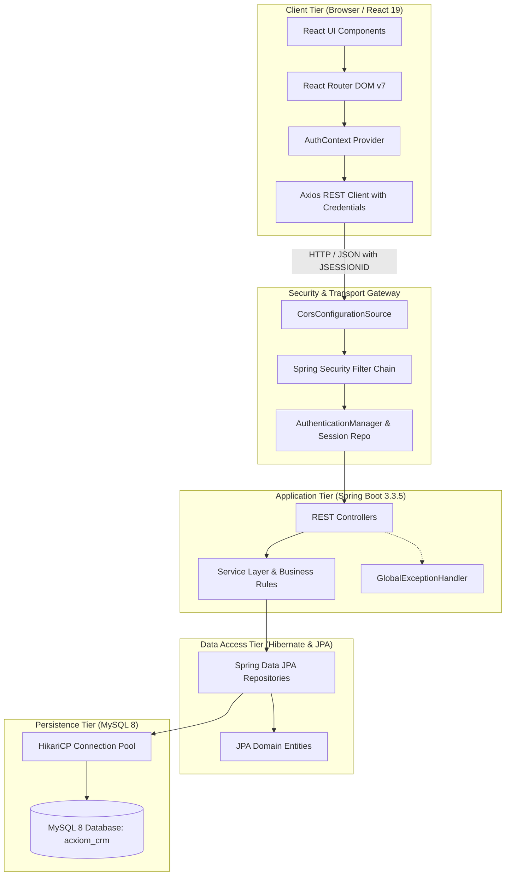
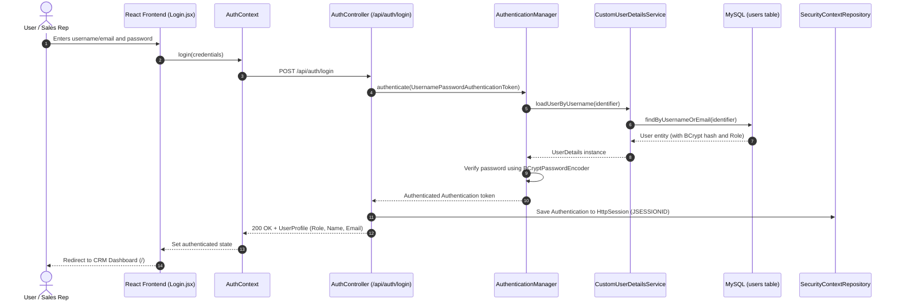
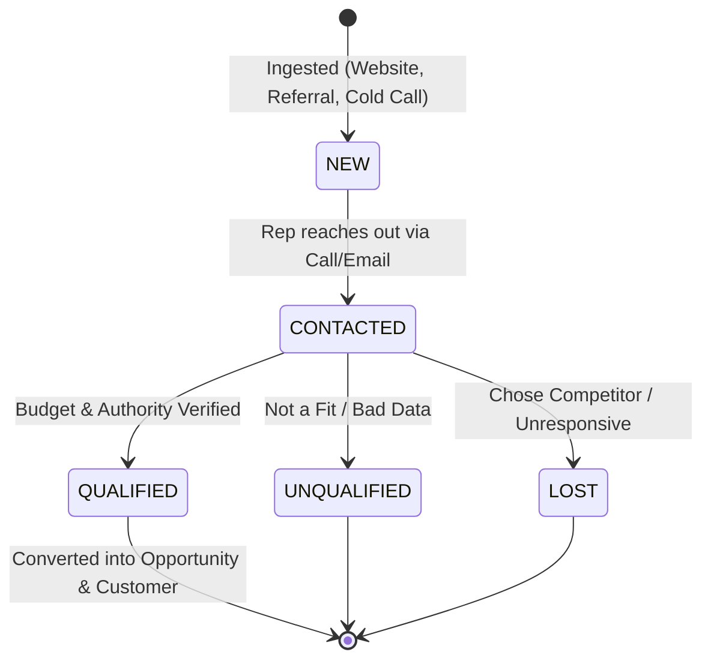
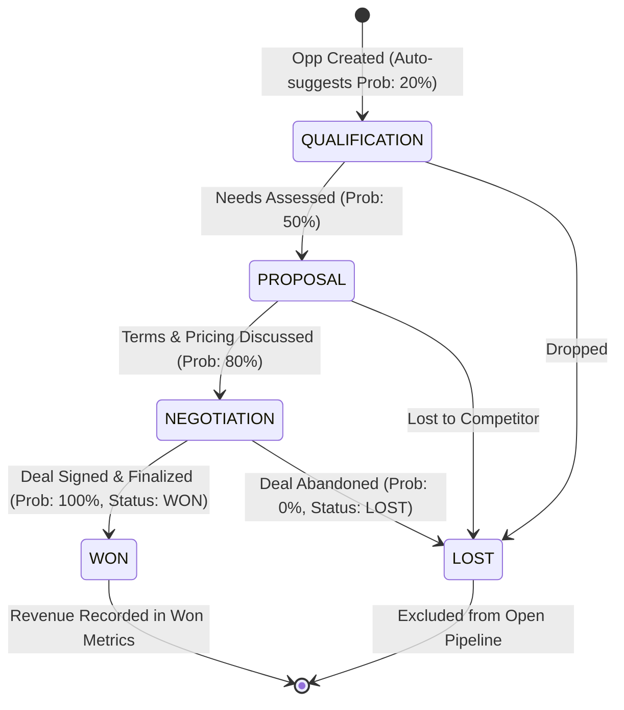
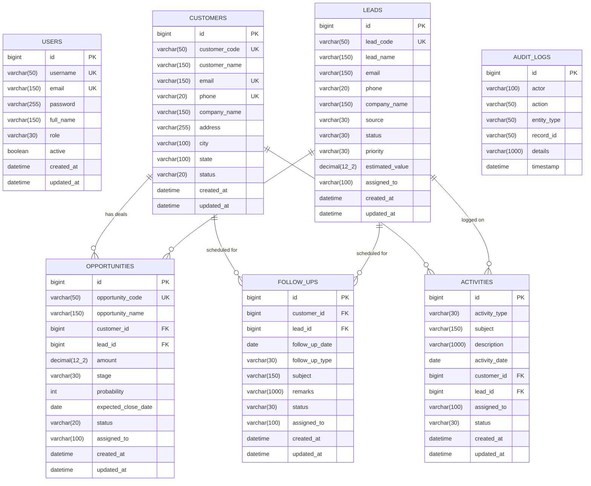

# AcxiomCRM — Comprehensive System Architecture & Engineering Documentation

**AcxiomCRM** is an enterprise-grade Customer Relationship Management (CRM) platform architected with a decoupled multi-tier design: a reactive Single Page Application (SPA) frontend built with **React 19** and **Vite**, an enterprise application backend powered by **Java 21**, **Spring Boot 3.3.5**, and **Spring Security 6**, backed by a relational **MySQL 8** database.

* **Author:** Sai Santanu Sahoo  
* **Institution:** C.V. Raman Global University, Bhubaneswar  
* **Version:** 1.0.0-SNAPSHOT  
* **Document Status:** Complete System Architecture & Operational Guide  

---

## Table of Contents

1. [Technology Stack](#1-technology-stack)
2. [Complete Folder & Directory Structure](#2-complete-folder--directory-structure)
3. [System Architecture & Workflow Design](#3-system-architecture--workflow-design)
   - [High-Level Tiered Architecture](#31-high-level-tiered-architecture)
   - [Authentication & Role-Based Access Control (RBAC)](#32-authentication--role-based-access-control-rbac)
   - [Core CRM Business Workflows](#33-core-crm-business-workflows)
     - [Lead Lifecycle & Pipeline Ingestion](#331-lead-lifecycle--pipeline-ingestion)
     - [Opportunity Pipeline & Financial Revenue Engine](#332-opportunity-pipeline--financial-revenue-engine)
     - [Customer Management & Soft Deactivation](#333-customer-management--soft-deactivation)
     - [Engagement Touchpoints: Follow-Ups & Activities](#334-engagement-touchpoints-follow-ups--activities)
     - [Analytics, KPI Aggregation & Report Generation](#335-analytics-kpi-aggregation--report-generation)
     - [System Audit Logging & Compliance](#336-system-audit-logging--compliance)
4. [System Working: Component-by-Component Deep Dive](#4-system-working-component-by-component-deep-dive)
   - [Frontend Architecture & Execution](#41-frontend-architecture--execution)
   - [Backend Architecture & Request Lifecycle](#42-backend-architecture--request-lifecycle)
5. [Database Schema & Entity Relationship Diagram (ERD)](#5-database-schema--entity-relationship-diagram-erd)
6. [REST API Endpoint Catalog](#6-rest-api-endpoint-catalog)
7. [Environment Configuration & Deployment Guide](#7-environment-configuration--deployment-guide)

---

## 1. Technology Stack

### 1.1 Frontend Layer
| Technology / Library | Version | Role & Architectural Purpose |
|---|---|---|
| **React** | `^19.2.8` | Declarative component UI library, virtual DOM rendering, and unidirectional data flow |
| **Vite** | `^8.3.0` | Next-generation ESM development server and Rollup production bundler |
| **React Router DOM** | `^7.18.4` | Declarative client-side routing, protected navigation guards, and history management |
| **Bootstrap** | `^5.3.8` | Responsive grid system, typography, modal primitives, and UI utilities |
| **Axios** | `^1.20.0` | Promise-based HTTP client with centralized interceptors, credentials support, and base URLs |
| **Chart.js** | `^4.5.1` | HTML5 canvas-based interactive data visualization for stage distributions, metrics, and trends |
| **jsPDF & html2canvas** | `^4.2.1` / `^1.4.1` | Client-side DOM rasterization and high-fidelity PDF report generation |
| **React Icons** | `^5.7.0` | Comprehensive icon sets (Feather, FontAwesome, Bootstrap Icons, Material) |
| **Oxlint** | `^1.81.0` | High-performance Rust-based linter for clean, bug-free JavaScript/JSX |

### 1.2 Backend Layer
| Technology / Framework | Version | Role & Architectural Purpose |
|---|---|---|
| **Java Platform, Standard Edition** | `21 (LTS)` | Core runtime using modern language features (Pattern Matching, Records, Stream toList) |
| **Spring Boot** | `3.3.5` | Application framework providing dependency injection, autoconfiguration, and embedded Tomcat |
| **Spring Security** | `6.x` | Enterprise authentication, session management, BCrypt password hashing, and method-level RBAC (`@PreAuthorize`) |
| **Spring Data JPA / Hibernate** | `3.3.5` | Object-Relational Mapping (ORM), automated query generation, lazy loading, and transactional boundaries |
| **Jakarta Bean Validation** | `3.0.x` | Declarative constraint validation (`@NotNull`, `@Size`, `@Email`, `@Valid`) on incoming DTOs |
| **HikariCP** | `5.1.0` | High-performance, low-latency JDBC connection pool manager |
| **MySQL Connector/J** | `8.x` | Native JDBC driver for robust client-server communications with MySQL 8 |
| **Apache Maven** | `3.9+` | Build automation, dependency management, compilation, and JAR packaging |

### 1.3 Database & Infrastructure Layer
| Component | Specification | Description |
|---|---|---|
| **Database Server** | MySQL 8.0+ Community Server | ACID-compliant relational persistence with InnoDB storage engine |
| **Character Set & Collation** | `utf8mb4` / `utf8mb4_unicode_ci` | Full multilingual Unicode character support (including emojis and international text) |
| **Communication Protocol** | HTTP / RESTful JSON | Stateless, uniform REST contracts wrapped in standardized `ApiResponse<T>` envelopes |
| **Authentication Transport** | HTTP-Only Session Cookie | JSESSIONID with `SameSite=Lax` and cross-origin credential sharing (`withCredentials: true`) |

---

## 2. Complete Folder & Directory Structure

```text
AcxiomCRM/
├── .env                                # Local environment secrets (ignored by Git)
├── .env.example                        # Template for environment variables
├── .gitignore                          # Root ignore patterns (secrets, target, dist, node_modules)
├── DOCUMENTATION.md                    # Comprehensive System Documentation (this file)
├── README.md                           # Project introduction, quickstart & credentials
│
├── frontend/                           # React 19 + Vite Frontend SPA
│   ├── index.html                      # HTML5 entry shell with Google Fonts & viewport metadata
│   ├── package.json                    # Frontend dependencies, scripts, and build pipeline
│   ├── vite.config.js                  # Vite server configuration (Port 5173, React plugin)
│   ├── public/                         # Static assets served without bundling
│   └── src/
│       ├── main.jsx                    # React bootstrapping, Bootstrap JS/CSS imports, DOM mount
│       ├── App.jsx                     # Route definitions, RootRoute guard, AuthProvider binding
│       ├── App.css                     # Global custom styles and theme overrides
│       ├── index.css                   # Enterprise navy design tokens, badges, and layout utilities
│       │
│       ├── assets/                     # Images, brand logos, and static illustrations
│       │
│       ├── components/                 # Reusable UI components & modals
│       │   ├── ActivityForm.jsx        # Modal form for logging/editing interaction activities
│       │   ├── CustomerForm.jsx        # Modal form for customer creation, edit & validation
│       │   ├── ErrorBoundary.jsx       # Fallback UI catcher preventing entire app crash on render errors
│       │   ├── FollowUpForm.jsx        # Modal form for scheduling/updating customer/lead follow-ups
│       │   ├── LeadForm.jsx            # Modal form for lead capture, source, priority & status
│       │   ├── Navbar.jsx              # Header bar with user profile, role badge, live backend ping & logout
│       │   ├── OpportunityForm.jsx     # Complex pipeline modal linking customer/lead with auto win-probabilities
│       │   ├── ProtectedRoute.jsx      # Route-guard enforcing authentication and role permissions
│       │   └── Sidebar.jsx             # Collapsible dark navy navigation menu with route highlighting
│       │
│       ├── context/                    # Global React Context providers
│       │   └── AuthContext.jsx         # Authentication state, login(), logout(), user profile, and roles
│       │
│       ├── layouts/                    # Structural layout wrappers
│       │   └── MainLayout.jsx          # Shell combining Sidebar, Navbar, and `<Outlet />` content area
│       │
│       ├── pages/                      # Page-level route views
│       │   ├── Activities.jsx          # Activity log view (calls, emails, meetings, tasks) with filters
│       │   ├── Customers.jsx           # Customer management with search, filtering, and CRUD operations
│       │   ├── Dashboard.jsx           # Executive overview, live KPI cards, pipeline charts, quick actions
│       │   ├── FollowUps.jsx           # Follow-up tracker with overdue warnings, status transitions & filters
│       │   ├── LandingPage.jsx         # Public marketing page with hero banner, feature highlights & login CTA
│       │   ├── Leads.jsx               # Lead conversion pipeline, source categorization, and rep assignment
│       │   ├── Login.jsx               # Secure authentication portal with pre-filled test user credentials
│       │   ├── Opportunities.jsx       # Sales pipeline board with weighted forecast KPI metrics & stage tracker
│       │   ├── PlaceholderPage.jsx     # Reusable boilerplate page for modular extensions
│       │   ├── Reports.jsx             # Comprehensive BI reports with Chart.js charts and PDF export
│       │   └── Settings.jsx            # Admin control center (user management, RBAC, audit log viewer)
│       │
│       └── services/                   # Centralized Axios API abstraction layer
│           ├── activityService.js      # REST client for `/api/activities`
│           ├── api.js                  # Centralized Axios instance with baseURL and `withCredentials: true`
│           ├── authService.js          # REST client for `/api/auth` (login, logout, me)
│           ├── crmService.js           # REST client for system health `/api/health`
│           ├── customerService.js      # REST client for `/api/customers`
│           ├── dashboardService.js     # REST client for `/api/dashboard/stats`
│           ├── followUpService.js      # REST client for `/api/follow-ups`
│           ├── leadService.js          # REST client for `/api/leads`
│           └── opportunityService.js   # REST client for `/api/opportunities`
│
└── backend/                            # Spring Boot 3 + Java 21 REST API Backend
    ├── pom.xml                         # Maven project descriptor, dependencies & Java 21 compiler plugins
    └── src/
        ├── main/
        │   ├── java/com/acxiom/crm/
        │   │   ├── AcxiomCrmApplication.java   # Spring Boot bootstrap entry point (`@SpringBootApplication`)
        │   │   │
        │   │   ├── config/                     # Application configurations & bootstrap runners
        │   │   │   ├── CorsConfig.java         # Global CORS configuration mapping allowed frontend origins
        │   │   │   ├── DataInitializer.java   # CommandLineRunner auto-seeding default Admin, Manager, Sales users
        │   │   │   └── SecurityConfig.java     # Spring Security 6 RBAC, BCrypt encoder, filter chain & session config
        │   │   │
        │   │   ├── controller/                 # REST Controllers handling HTTP requests
        │   │   │   ├── ActivityController.java     # Endpoints for interactions & activity logs
        │   │   │   ├── AdminController.java        # Protected admin endpoints for user & role management
        │   │   │   ├── AuditLogController.java     # Protected admin endpoints for security audit logs
        │   │   │   ├── AuthController.java         # Endpoints for authentication (`/api/auth/login`, `logout`, `me`)
        │   │   │   ├── CustomerController.java     # Endpoints for customer CRUD, search & status toggling
        │   │   │   ├── DashboardController.java    # Aggregated KPI metrics & pipeline distribution endpoints
        │   │   │   ├── FollowUpController.java     # Endpoints for task reminders & follow-up tracking
        │   │   │   ├── HealthController.java       # Database and service liveness probe (`/api/health`)
        │   │   │   ├── LeadController.java         # Endpoints for lead lifecycle management
        │   │   │   └── OpportunityController.java  # Endpoints for sales pipeline, stages & weighted forecasts
        │   │   │
        │   │   ├── dto/                        # Data Transfer Objects (Request/Response contracts)
        │   │   │   ├── ActivityRequest.java        # Inbound payload for creating/updating an Activity
        │   │   │   ├── ActivityResponse.java       # Outbound flattened representation of an Activity
        │   │   │   ├── ApiResponse.java            # Standard generic envelope (`success`, `message`, `data`, `timestamp`)
        │   │   │   ├── AuthResponse.java           # Authentication payload returning user details and role
        │   │   │   ├── CreateUserRequest.java      # Admin inbound payload for registering new CRM users
        │   │   │   ├── CustomerRequest.java        # Inbound payload for customer creation/update with validations
        │   │   │   ├── CustomerResponse.java       # Outbound sanitized customer record
        │   │   │   ├── DashboardStatsResponse.java # Aggregated metrics payload for charts, KPIs and distributions
        │   │   │   ├── FollowUpRequest.java        # Inbound payload for scheduling follow-ups
        │   │   │   ├── FollowUpResponse.java       # Outbound follow-up record with computed urgency/overdue flags
        │   │   │   ├── HealthResponse.java         # Health check diagnostics payload (status, database, timestamp)
        │   │   │   ├── LeadRequest.java            # Inbound payload for lead ingestion
        │   │   │   ├── LeadResponse.java           # Outbound lead record with stage & assignment
        │   │   │   ├── LoginRequest.java           # Credentials payload (username/email + password)
        │   │   │   ├── OpportunityRequest.java     # Inbound opportunity payload with financial amount & stage
        │   │   │   ├── OpportunityResponse.java    # Circular-reference safe opportunity representation
        │   │   │   ├── PipelineSummaryResponse.java# Financial summary (total pipeline, weighted value, won revenue)
        │   │   │   └── UserResponse.java           # Sanitized user record (excludes BCrypt password hash)
        │   │   │
        │   │   ├── entity/                     # JPA Entities mapped to MySQL database tables
        │   │   │   ├── Activity.java               # Entity mapped to `activities` table
        │   │   │   ├── ActivityStatus.java         # Enum: PLANNED, COMPLETED, CANCELLED
        │   │   │   ├── ActivityType.java           # Enum: CALL, EMAIL, MEETING, NOTE, TASK
        │   │   │   ├── AuditLog.java               # Entity mapped to `audit_logs` table
        │   │   │   ├── Customer.java               # Entity mapped to `customers` table (with unique `customer_code`)
        │   │   │   ├── CustomerStatus.java         # Enum: ACTIVE, INACTIVE
        │   │   │   ├── FollowUp.java               # Entity mapped to `follow_ups` table
        │   │   │   ├── FollowUpStatus.java         # Enum: PLANNED, COMPLETED, CANCELLED
        │   │   │   ├── FollowUpType.java           # Enum: CALL, EMAIL, MEETING, DEMO
        │   │   │   ├── Lead.java                   # Entity mapped to `leads` table (with unique `lead_code`)
        │   │   │   ├── LeadPriority.java           # Enum: LOW, MEDIUM, HIGH, URGENT
        │   │   │   ├── LeadSource.java             # Enum: WEBSITE, REFERRAL, COLD_CALL, CAMPAIGN, OTHER
        │   │   │   ├── LeadStatus.java             # Enum: NEW, CONTACTED, QUALIFIED, UNQUALIFIED, LOST
        │   │   │   ├── Opportunity.java            # Entity mapped to `opportunities` table (with `opportunity_code`)
        │   │   │   ├── OpportunityStage.java       # Enum: QUALIFICATION, PROPOSAL, NEGOTIATION, WON, LOST
        │   │   │   ├── OpportunityStatus.java      # Enum: OPEN, WON, LOST
        │   │   │   ├── Role.java                   # Enum: ADMIN, MANAGER, SALES_EXECUTIVE
        │   │   │   └── User.java                   # Entity mapped to `users` table
        │   │   │
        │   │   ├── exception/                  # Centralized exception handling
        │   │   │   ├── DuplicateResourceException.java # Thrown when unique constraints (email, phone, code) fail
        │   │   │   ├── ErrorResponse.java          # Standardized error response structure
        │   │   │   ├── GlobalExceptionHandler.java # `@RestControllerAdvice` mapping exceptions to HTTP status codes
        │   │   │   └── ResourceNotFoundException.java  # Thrown when entity lookups by ID/Code yield empty results
        │   │   │
        │   │   ├── repository/                 # Spring Data JPA Repository interfaces
        │   │   │   ├── ActivityRepository.java     # Queries on `activities` table
        │   │   │   ├── AuditLogRepository.java     # Queries on `audit_logs` table (ordered by timestamp DESC)
        │   │   │   ├── CustomerRepository.java     # Queries on `customers` table (existsByEmail, existsByPhone, etc.)
        │   │   │   ├── FollowUpRepository.java     # Queries on `follow_ups` table
        │   │   │   ├── LeadRepository.java         # Queries on `leads` table
        │   │   │   ├── OpportunityRepository.java  # Queries on `opportunities` table
        │   │   │   └── UserRepository.java         # Lookups by username or email for authentication
        │   │   │
        │   │   └── service/                    # Business logic and domain service interfaces & implementations
        │   │       ├── ActivityService.java        # Activity creation, filtering, and audit log generation
        │   │       ├── AuditLogService.java        # Asynchronous/synchronous security audit trail logger
        │   │       ├── CustomUserDetailsService.java # Implements Spring Security `UserDetailsService`
        │   │       ├── CustomerService.java        # Code generation, duplicate checking, soft deactivation
        │   │       ├── DashboardService.java       # Real-time metrics calculation, stage aggregation, role scoping
        │   │       ├── FollowUpService.java        # Follow-up scheduling, overdue checks, status transitions
        │   │       ├── HealthService.java          # Low-level JDBC connection test and system readiness check
        │   │       ├── LeadService.java            # Lead intake, status lifecycle, validation & code generation
        │   │       └── OpportunityService.java     # Financial pipeline calculations, stage validation, revenue math
        │   │
        │   └── resources/
        │       └── application.properties      # Database credentials, connection pool parameters, port, and logging
        │
        └── test/                               # Automated unit & integration tests
```

---

## 3. System Architecture & Workflow Design

### 3.1 High-Level Tiered Architecture

AcxiomCRM implements a **Tiered Client-Server Architecture** designed for horizontal scalability, high cohesion, and strict separation of concerns.



---

### 3.2 Authentication & Role-Based Access Control (RBAC)

Authentication is implemented via Spring Security's stateful session management backed by BCrypt password encryption.



#### Role & Permission Matrix
AcxiomCRM defines three distinct enterprise roles:

| Module / Operation | `ADMIN` | `MANAGER` | `SALES_EXECUTIVE` |
|---|:---:|:---:|:---:|
| **Dashboard & Global KPIs** | Full Company Scope | Full Company Scope | Scoped to Assigned Records |
| **Customers (Create / View / Edit)** | ✅ Full Access | ✅ Full Access | ✅ Full Access |
| **Customers (Soft Deactivate / Delete)** | ✅ Full Access | ✅ Full Access | ❌ Read / Update Only |
| **Leads (Create / View / Edit)** | ✅ Full Access | ✅ Full Access | ✅ Assigned Only |
| **Opportunities (Create / View / Edit)** | ✅ Full Access | ✅ Full Access | ✅ Assigned Only |
| **Follow-Ups & Activities** | ✅ Full Access | ✅ Full Access | ✅ Full Access |
| **Executive Reports & Analytics** | ✅ Full Access | ✅ Full Access | ❌ Restricted |
| **User Administration & Password Resets** | ✅ Full Access | ❌ Restricted | ❌ Restricted |
| **System Security Audit Logs** | ✅ Full Access | ❌ Restricted | ❌ Restricted |

---

### 3.3 Core CRM Business Workflows

#### 3.3.1 Lead Lifecycle & Pipeline Ingestion
Leads are the initial prospective contacts entering the CRM funnel.



1. **Lead Creation:** A unique human-readable code (`LEAD-XXXXXX`) is automatically generated. The lead is tagged with source, priority, estimated revenue, and assigned sales representative.
2. **Engagement:** Activities (Calls, Emails, Meetings) and planned Follow-Ups are linked directly to the Lead record.
3. **Qualification:** Once verified, the lead transitions to `QUALIFIED`, allowing immediate conversion into an Opportunity.

---

#### 3.3.2 Opportunity Pipeline & Financial Revenue Engine
The opportunity pipeline represents potential high-value revenue transactions linked to qualified leads and customers.



#### Financial Accuracy & Mathematical Formulations
All financial calculations use Java's `BigDecimal` and MySQL's `DECIMAL(12, 2)` to eliminate floating-point rounding inaccuracies:

* **Weighted Pipeline Value:**
  $$\text{Weighted Value} = \frac{\text{Amount} \times \text{Probability}}{100}$$
* **Open Pipeline Total:**
  $$\text{Open Pipeline} = \sum_{\substack{o \in \text{Opportunities} \\ o.\text{stage} \notin \{\text{WON}, \text{LOST}\}}} o.\text{amount}$$
* **Weighted Open Pipeline Total:**
  $$\text{Weighted Open Pipeline} = \sum_{\substack{o \in \text{Opportunities} \\ o.\text{stage} \notin \{\text{WON}, \text{LOST}\}}} \left( \frac{o.\text{amount} \times o.\text{probability}}{100} \right)$$
* **Total Won Revenue:**
  $$\text{Won Revenue} = \sum_{\substack{o \in \text{Opportunities} \\ o.\text{stage} = \text{WON}}} o.\text{amount}$$

---

#### 3.3.3 Customer Management & Soft Deactivation
Customers represent active commercial accounts.
* **Unique Identification:** Every customer receives an indexed code: `CUST-XXXXXX`.
* **Duplicate Prevention:** The service layer verifies that `email` and `phone` are unique across all records before persisting new records, throwing `DuplicateResourceException` if collisions occur.
* **Soft Deactivation:** Rather than immediately dropping historical data, customers can be transitioned between `ACTIVE` and `INACTIVE` status to preserve audit integrity and historical activity links.

---

#### 3.3.4 Engagement Touchpoints: Follow-Ups & Activities
AcxiomCRM differentiates between planned schedule events (**Follow-Ups**) and executed historical interactions (**Activities**):
* **Follow-Ups:**
  - Types: `CALL`, `EMAIL`, `MEETING`, `DEMO`.
  - Statuses: `PLANNED`, `COMPLETED`, `CANCELLED`.
  - **Overdue Engine:** A query filter calculates whether a follow-up's date is strictly before the current date (`followUpDate.isBefore(today)`) while remaining in `PLANNED` status. These are flagged with red warning badges on the dashboard and follow-up view.
* **Activities:**
  - Types: `CALL`, `EMAIL`, `MEETING`, `NOTE`, `TASK`.
  - Automatically records historical interactions with customers or leads, including notes, duration, and assigned personnel.

---

#### 3.3.5 Analytics, KPI Aggregation & Report Generation
* **Live Dashboard:** Fetches aggregated metrics via `GET /api/dashboard/stats`. If the authenticated user is a `SALES_EXECUTIVE`, the service automatically filters metrics to only include records assigned to that executive's username.
* **Executive Reports:** The Reports module calculates conversion ratios, win rates, and stage distribution charts rendered via Chart.js.
* **Client-Side Export:** Users can export reports to PDF via `jspdf` and `html2canvas` for executive presentations.

---

#### 3.3.6 System Audit Logging & Compliance
* The `AuditLog` subsystem records security-critical actions (`LOGIN`, `LOGOUT`, `USER_CREATED`, `USER_DEACTIVATED`, `CUSTOMER_MODIFIED`, `PASSWORD_RESET`).
* Every log stores the actor's username, action performed, entity type, record identifier, details, and timestamp.
* Audit logs are immutable (read-only) and only accessible to users with the `ADMIN` role via `GET /api/admin/audit-logs`.

---

## 4. System Working: Component-by-Component Deep Dive

### 4.1 Frontend Architecture & Execution

#### 1. Bootstrapping (`main.jsx` & `App.jsx`)
* `main.jsx` imports Bootstrap 5 styles, custom CSS tokens (`index.css`), and mounts `<App />` within the React 19 root.
* `App.jsx` wraps the application within an `<ErrorBoundary>` and the `<AuthProvider>`, setting up client-side routes.

#### 2. Root Route Resolution (`RootRoute`)
```javascript
// App.jsx
function RootRoute() {
  const { isAuthenticated, loading } = useAuth();
  if (loading) return <LoadingSpinner />;
  if (!isAuthenticated) return <LandingPage />;
  return <MainLayout />;
}
```
* **Unauthenticated Visitors:** Navigating to `/` displays the `LandingPage` with feature showcases, platform stats, and a "Sign In to Portal" call to action.
* **Authenticated Users:** Navigating to `/` automatically renders the `MainLayout` containing the live `Dashboard`.

#### 3. State Management via `AuthContext.jsx`
* Maintains user authentication state across browser refreshes by pinging `GET /api/auth/me` on startup.
* Provides `login(usernameOrEmail, password)` and `logout()` helpers to child components.
* Automatically wipes user context and redirects to `/login` if any API request returns an HTTP `401 Unauthorized`.

#### 4. Protected Routing (`ProtectedRoute.jsx`)
* Intercepts route transitions. If the user is unauthenticated, they are redirected to `/login`.
* Validates role permissions using the `allowedRoles` array (e.g., restricting `/settings` to `['ADMIN']` and `/reports` to `['ADMIN', 'MANAGER']`).

#### 5. Centralized HTTP Transport (`api.js`)
* Configures Axios with:
  ```javascript
  const api = axios.create({
    baseURL: 'http://localhost:8080/api',
    withCredentials: true, // Ensures JSESSIONID cookie is transmitted in cross-origin requests
    headers: { 'Content-Type': 'application/json', 'Accept': 'application/json' }
  });
  ```

---

### 4.2 Backend Architecture & Request Lifecycle

When an HTTP request is received by the Spring Boot backend, it traverses the following pipeline:

```text
HTTP Request
     │
     ▼
[CorsFilter / SecurityFilterChain]
     │ ── Checks CORS origin (http://localhost:5173)
     │ ── Evaluates URL matchers (.requestMatchers("/api/admin/**").hasRole("ADMIN"))
     │ ── Restores SecurityContext from HttpSession
     ▼
[DispatcherServlet]
     │ ── Resolves Route to Controller Method
     ▼
[Controller Layer]
     │ ── Validates DTO annotations (@Valid, @NotNull, @Email, etc.)
     │ ── If validation fails: MethodArgumentNotValidException caught by GlobalExceptionHandler
     ▼
[Service Layer (@Transactional)]
     │ ── Enforces business rules (duplicate detection, calculation formulas)
     │ ── Generates unique entity codes (CUST-XXXXXX, LEAD-XXXXXX, OPP-XXXXXX)
     │ ── Scopes queries based on SecurityContextHolder credentials
     ▼
[Repository Layer (Spring Data JPA)]
     │ ── Translates domain queries into optimized SQL
     ▼
[HikariCP Connection Pool -> MySQL Database]
     │ ── Executes SQL query and returns result set
     ▼
[DTO Assembly & JSON Serialization]
     │ ── Converts JPA Entity into clean DTO (preventing circular reference loops)
     │ ── Wraps payload inside ApiResponse<T>
     ▼
HTTP 200 OK Response
```

#### Centralized Exception Handling (`GlobalExceptionHandler.java`)
All uncaught exceptions are intercepted and converted into standard JSON error objects:
* `ResourceNotFoundException` $\rightarrow$ `HTTP 404 Not Found`
* `DuplicateResourceException` $\rightarrow$ `HTTP 409 Conflict`
* `MethodArgumentNotValidException` $\rightarrow$ `HTTP 400 Bad Request` (with detailed field validation errors)
* `BadCredentialsException` $\rightarrow$ `HTTP 401 Unauthorized`
* `AccessDeniedException` $\rightarrow$ `HTTP 403 Forbidden`
* `Exception` (General) $\rightarrow$ `HTTP 500 Internal Server Error`

---

## 5. Database Schema & Entity Relationship Diagram (ERD)

The relational schema is normalized with foreign-key integrity, unique indices, and performance-tuned composite indices.



---

## 6. REST API Endpoint Catalog

All API endpoints return a standardized payload envelope:
```json
{
  "success": true,
  "message": "Operation description",
  "data": { ... },
  "timestamp": "2026-10-25T17:00:00.000"
}
```

### 6.1 Authentication (`/api/auth`)
| Method | Endpoint | Access Level | Description |
|---|---|---|---|
| `POST` | `/api/auth/login` | Public | Authenticates credentials and issues `JSESSIONID` session cookie |
| `POST` | `/api/auth/logout` | Authenticated | Terminates active session and clears security context |
| `GET` | `/api/auth/me` | Authenticated | Retrieves current authenticated user profile and assigned role |

### 6.2 System Health (`/api/health`)
| Method | Endpoint | Access Level | Description |
|---|---|---|---|
| `GET` | `/api/health` | Public | Verifies application readiness and active MySQL JDBC connectivity |

### 6.3 Customers (`/api/customers`)
| Method | Endpoint | Access Level | Description |
|---|---|---|---|
| `GET` | `/api/customers` | Authenticated | Retrieves all customers (supports optional `?search=` and `?status=`) |
| `GET` | `/api/customers/{id}` | Authenticated | Retrieves single customer by database ID |
| `POST` | `/api/customers` | Authenticated | Creates a new customer with auto-generated `customerCode` |
| `PUT` | `/api/customers/{id}` | Authenticated | Updates existing customer details |
| `PATCH`| `/api/customers/{id}/status`| Authenticated | Toggles customer status between `ACTIVE` and `INACTIVE` |
| `DELETE`| `/api/customers/{id}`| Admin / Manager | Permanently deletes a customer record |

### 6.4 Leads (`/api/leads`)
| Method | Endpoint | Access Level | Description |
|---|---|---|---|
| `GET` | `/api/leads` | Authenticated | Retrieves leads (with optional filters for `?status=`, `?source=`, `?search=`) |
| `GET` | `/api/leads/{id}` | Authenticated | Retrieves single lead by ID |
| `POST` | `/api/leads` | Authenticated | Creates a new lead with auto-generated `leadCode` |
| `PUT` | `/api/leads/{id}` | Authenticated | Updates existing lead |
| `PATCH`| `/api/leads/{id}/status`| Authenticated | Updates lead status (e.g., `NEW` $\rightarrow$ `CONTACTED` $\rightarrow$ `QUALIFIED`) |
| `DELETE`| `/api/leads/{id}`| Admin / Manager | Deletes a lead record |

### 6.5 Opportunities (`/api/opportunities`)
| Method | Endpoint | Access Level | Description |
|---|---|---|---|
| `GET` | `/api/opportunities` | Authenticated | Retrieves all opportunities (supports `?stage=`, `?status=`, `?search=`) |
| `GET` | `/api/opportunities/{id}` | Authenticated | Retrieves opportunity by ID |
| `GET` | `/api/opportunities/summary` | Authenticated | Computes total pipeline value, weighted pipeline, and won revenue |
| `POST` | `/api/opportunities` | Authenticated | Creates a new opportunity (validates amount & auto-links customer/lead) |
| `PUT` | `/api/opportunities/{id}` | Authenticated | Updates opportunity details |
| `PATCH`| `/api/opportunities/{id}/stage`| Authenticated | Transitions stage (`QUALIFICATION` $\rightarrow$ `PROPOSAL` $\rightarrow$ `WON`/`LOST`) |
| `DELETE`| `/api/opportunities/{id}`| Admin / Manager | Deletes an opportunity record |

### 6.6 Follow-Ups (`/api/follow-ups`)
| Method | Endpoint | Access Level | Description |
|---|---|---|---|
| `GET` | `/api/follow-ups` | Authenticated | Retrieves follow-ups (supports `?status=` and `?overdue=true`) |
| `GET` | `/api/follow-ups/{id}` | Authenticated | Retrieves follow-up by ID |
| `POST` | `/api/follow-ups` | Authenticated | Schedules a new follow-up interaction |
| `PUT` | `/api/follow-ups/{id}` | Authenticated | Updates follow-up schedule and remarks |
| `PATCH`| `/api/follow-ups/{id}/complete`| Authenticated | Marks a follow-up as `COMPLETED` |
| `DELETE`| `/api/follow-ups/{id}`| Admin / Manager | Deletes a follow-up record |

### 6.7 Activities (`/api/activities`)
| Method | Endpoint | Access Level | Description |
|---|---|---|---|
| `GET` | `/api/activities` | Authenticated | Retrieves recent logged activities |
| `POST` | `/api/activities` | Authenticated | Logs a completed activity (call, email, meeting, note) |
| `DELETE`| `/api/activities/{id}` | Admin / Manager | Deletes an activity record |

### 6.8 Dashboard Metrics (`/api/dashboard`)
| Method | Endpoint | Access Level | Description |
|---|---|---|---|
| `GET` | `/api/dashboard/stats` | Authenticated | Aggregated KPI stats, stage distributions, and upcoming follow-ups |

### 6.9 Administration & Audit Logs (`/api/admin`)
| Method | Endpoint | Access Level | Description |
|---|---|---|---|
| `GET` | `/api/admin/users` | `ADMIN` only | Lists all registered system users |
| `POST` | `/api/admin/users` | `ADMIN` only | Registers a new user with BCrypt password hashing |
| `PATCH`| `/api/admin/users/{id}/role` | `ADMIN` only | Updates a user's security role (`ADMIN`, `MANAGER`, `SALES_EXECUTIVE`) |
| `PATCH`| `/api/admin/users/{id}/toggle-status` | `ADMIN` only | Enables or disables a user account |
| `POST` | `/api/admin/users/{id}/reset-password` | `ADMIN` only | Resets a user's password |
| `GET` | `/api/admin/audit-logs` | `ADMIN` only | Retrieves immutable system activity logs |

---

## 7. Environment Configuration & Deployment Guide

### 7.1 Prerequisites
* **Java Development Kit (JDK):** Version 21 or higher
* **Node.js & npm:** Node.js 18.x or higher, npm 9.x or higher
* **MySQL Database Server:** MySQL 8.0 or higher
* **Apache Maven:** Version 3.9+ (or use IDE bundled Maven)

---

### 7.2 Database Setup
Execute the following SQL commands in your MySQL client to provision the database:
```sql
CREATE DATABASE IF NOT EXISTS acxiom_crm 
CHARACTER SET utf8mb4 
COLLATE utf8mb4_unicode_ci;
```

---

### 7.3 Environment Variables Configuration
Create a `.env` file in the root workspace directory (`AcxiomCRM/.env`) based on `.env.example`:
```ini
# Database Connection
DB_URL=jdbc:mysql://localhost:3306/acxiom_crm?useSSL=false&allowPublicKeyRetrieval=true&serverTimezone=UTC
DB_USERNAME=root
DB_PASSWORD=your_mysql_password_here

# Server & CORS Ports
PORT=8080
CORS_ALLOWED_ORIGINS=http://localhost:5173

# Admin Bootstrap Credentials (Auto-seeded on first run)
ADMIN_USERNAME=admin
ADMIN_EMAIL=admin@acxiom.com
ADMIN_PASSWORD=Admin#1234
```

---

### 7.4 Running the Application

#### Step 1: Start the Spring Boot Backend
Open a terminal in `backend/`:
```bash
# Using Maven wrapper or local Maven
mvn clean compile
mvn spring-boot:run
```
* Backend starts on **`http://localhost:8080`**.
* The `DataInitializer` automatically seeds default accounts on first startup if the `users` table is empty.
* Health check: **`http://localhost:8080/api/health`**.

#### Step 2: Start the React Frontend
Open a separate terminal in `frontend/`:
```bash
# Install dependencies (first time only)
npm install

# Launch Vite development server
npm run dev
```
* Frontend starts on **`http://localhost:5173`**.

---

### 7.5 Pre-Configured Test Accounts

| Username | Password | Role | Primary Permissions |
|---|---|---|---|
| **`admin`** | `Admin#1234` | `ADMIN` | Full unrestricted access to all modules, User Management, Reports & Audit Logs |
| **`manager`** | `Manager#1234` | `MANAGER` | Full operational CRM access, Sales Pipeline, Opportunity & Executive Reports |
| **`sales`** | `Sales#1234` | `SALES_EXECUTIVE` | Field sales access, Customers, Leads, Deals & Follow-ups assigned to them |

---

### 7.6 Production Build & Packaging
* **Frontend Bundle:** Run `npm run build` inside `frontend/` to produce the optimized production assets in `frontend/dist/`.
* **Backend JAR Package:** Run `mvn clean package -DskipTests` inside `backend/` to generate `backend/target/acxiom-crm-backend-1.0.0-SNAPSHOT.jar`.
* Run the standalone JAR:
  ```bash
  java -jar backend/target/acxiom-crm-backend-1.0.0-SNAPSHOT.jar
  ```
